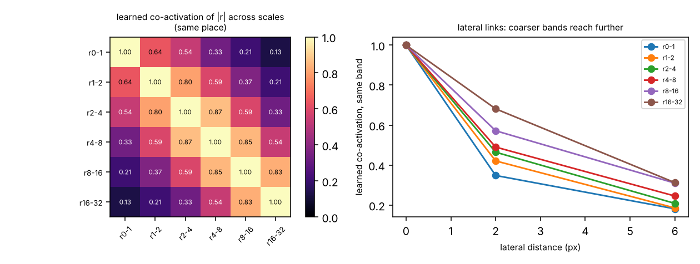
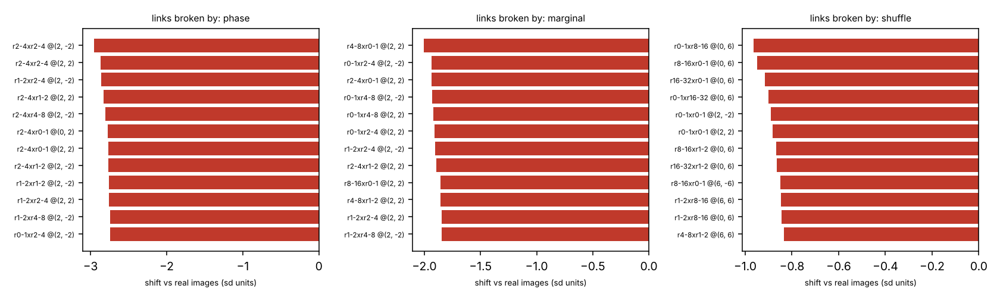
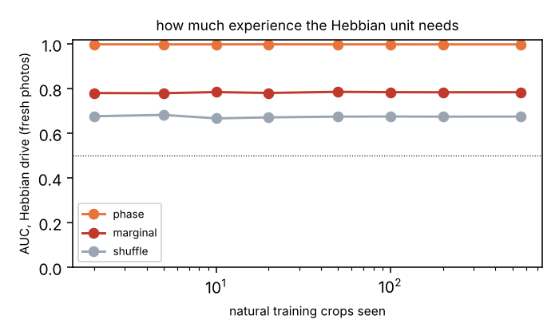

# ClaudeRepo1 — which configurations across the Sihti bands occur together?

> **Astra branch audit (22 October):** A2b's claim of two fresh source photographs
> is withdrawn: `cat` aliases the training image `chelsea`. Original receipts below
> are preserved, not rerun. The histogram/spectrum controls are approximate, not
> exact; their remaining marginal differences are predictive. See
> [the bounded audit and experience result](docs/ASTRA_RESULT.md).
> The new synthetic experience gate passes, **with ordinary ridge tying it**.
> No persistence network was built.


Gate A of the plan from the Oct 22 2026 Antti / Astra / Sol / Claude discussion: before building a
fast/slow persistence machine (Gate B), check whether a Hebbian relation layer over the Sihti bands
carries anything a frequency ledger cannot see. Everything was preregistered and pushed before the
test runs ([docs/PREREG_A.md](docs/PREREG_A.md), then [docs/PREREG_A2b.md](docs/PREREG_A2b.md)).

**Short version:** the structure is there and it is exactly where Freeman et al. said it would be, in
how *rectified* responses co-occur across scale and space. The Hebbian learning, on this test, adds
nothing: an untrained all-ones weight vector does as well.

## The setup

* **Sieve** (`sieve.py`): linear diffusion on a torus, bands r_k = x_{d_k} − x_{d_{k+1}} at depths
  0,1,2,4,8,16,32; lossless. Here, spatially averaged signed band correlations on a torus are fixed by the power spectrum.
* **Relation layer** (`relations.py`): per image, standardised activities of each band, either
  rectified |r_k| or signed r_k; the relation tensor R[k,k',δ] = mean_p a_k(p)·a_k'(p+δ) over all band
  pairs and 9 offsets (309 relations). Hebbian learning W ← W + (R − W)/n over natural training crops only.
* **Controls**, made from each test crop: `phase` (random phases, identical spectrum — Freeman's
  control), `marginal` (Heeger–Bergen: band histograms and spectrum re-imposed alternately),
  `shuffle` (16×16 blocks permuted; seams add new edges, so report-only).
* Training: 560 crops from 15 scikit-image photographs. Test: 150 crops from `camera`, `coffee`,
  `clock`; the original A2b gate on 100 crops from `cat`, `cell` (source overlap: `cat` is training `chelsea`).



The learned co-activations are readable. The same place lights up across neighbouring scales (0.80–0.87
between adjacent mid bands, falling to 0.13 between finest and coarsest), and laterally the coarser
bands reach further.

## Results

| gate | claim | result | |
|---|---|---|---|
| **A1** | rectified relations see what the spectrum cannot | typicality AUC real vs phase-scrambled **0.87**; linear relations **0.50** exactly (they are identical by construction) | **PASS** |
| **A2** | relations, beyond per-band shape (band-histogram-matched controls) | typicality AUC **0.40** (below chance) vs per-band shape 0.42 | **FAIL** |
| **A2b** | same, with the Hebbian unit's *drive* ⟨R, W⟩ as the readout, fresh photographs | **0.78** vs per-band shape 0.56; phase **0.998** | **PASS** |
| *post-hoc* | does the learning matter? | drive with W = all ones (no experience): **0.79**; learned W with entries shuffled: **0.79**; learned W after only 2 crops: **0.78** | **no** |



## What happened, honestly

1. **A1 is an analogous computational statistic, not a replication of V2 physiology.** Phase scrambling leaves every band's energy and every
   signed cross-band correlation identical (a test checks this to 10⁻⁹), and the linear relation
   layer scores exactly chance. The rectified layer sees the difference.
2. **A2 failed because of the readout, not the features.** The preregistered score was typicality:
   distance from the average learned co-activation. Each real photograph is atypical in its own way,
   while scrambles regress toward the average, so controls scored as *more* natural. A post-hoc
   supervised probe (`diagnose_a.py`) showed the information was there: 0.97 for rectified relations
   vs 0.87 for per-band shape on the matched controls.
3. **A2b changed the readout and met its numerical threshold, but its fresh-source claim failed the later audit.** A Hebbian unit does
   not measure distance to its weights; it responds with its drive, the overlap of input and weights.
4. **Then the deflation.** Every learned co-activation is positive (0.009 to 0.87), so the controls show little benefit from the arrangement of W on this test (positivity alone would not establish that). The drive is essentially *how much rectified activity coincides across scale
   and nearby space*, and that is what tells a photograph from its scrambles: edges line up across
   scales in real images, and in scrambles they do not. That statistic is known (the cross-scale
   magnitude dependencies of Simoncelli and colleagues; the Portilla–Simoncelli texture statistics
   Freeman used). The rectification is what matters. The learning is not, on this test.



## What this means for Gate B

The preregistered condition for building Gate B (A2b passes) is met, but building it now would test
the wrong thing. A slow recurrent state supported by this W would be supported by "any coincident
rectified activity". That is a coherence amplifier, and it needs no experience. Learning only
becomes necessary when the task needs **specific** relations: telling a bird from a rearrangement of
bird pieces (Rust & DiCarlo's selectivity), or one learned category from another. Gate A's shuffle
control was the nearest thing to that, and untrained weights did as well there too (0.71 vs 0.68).

So the next honest step is a selectivity gate before Gate B: relations learned from one kind of
image must tell that kind from another *natural* kind that has the same "edges align across
scales" property, and must beat an untrained W at doing so.

## Run it

```bash
pip install -r requirements.txt pytest
python -m pytest -q          # 5 tests: lossless sieve, phase scramble keeps every linear relation, ...
python gate_a.py             # Gate A (about a minute)
python diagnose_a.py         # post-hoc probe
python gate_a2b.py           # A2b; gate_a2b.curve_figure() and no_learning_control() for the rest
python gate_a.py --folders ~/THINGS/unseen --name folders   # test crops from your own photos
```

## Prior art

Freeman, Ziemba, Heeger, Simoncelli & Movshon 2013 (V2 and naturalistic texture statistics);
Portilla & Simoncelli 2000; Heeger & Bergen 1995; Simoncelli 1997 / Buccigrossi & Simoncelli 1999
(cross-scale magnitude dependencies); Rust & DiCarlo 2010 (selectivity and tolerance);
Freeman & Simoncelli 2011 (metamers of the ventral stream).
