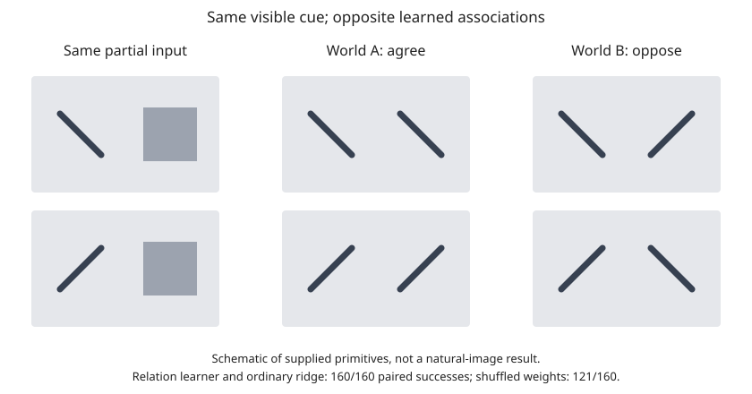

# One branch: source/control audit and an experience gate

Base: `67303a6`; protocol pushed as `640490c` before the experiment ran.
Budget: five fixed seeds, 64 training pairs per environment and 32 test cues per
seed; CPU only, no tuning or new photographic benchmark. Original results retained.

## What needed correction

- `skimage.data.cat is skimage.data.chelsea` is true. Training used chelsea; half
  of A2b's 100 nominally fresh crops came from that same source photograph. Crop
  identity need not be equal for the photograph-level holdout claim to fail.
- Corrected A2b defaults are cell and eagle, with a source-alias guard and new
  result filenames. **Those corrected photograph experiments have not been run.**
  The old 0.7843 receipt is not a corrected holdout result.
- The marginal control alternates constraints and finishes with independently
  histogram-matched overlapping bands. Summing those bands changes the spectrum;
  reanalysis does not necessarily recover their matched histograms. Added an audit
  of the final image, using relative L2 spectrum and sorted-coefficient errors.
  The offline receipt contains three synthetic fixtures, not natural-photo estimates.
- The existing post-hoc per-band-only supervised probe scores 0.8733 accuracy on
  these controls. Thus a weak per-band drive baseline does not isolate relations
  from all remaining marginal information.
- Signed-correlation invariance applies to the spatially averaged convolutional
  statistics used here, not every possible linear readout. Absolute-value relations
  are nonlinear statistics, not literally fourth-order polynomials.

## Small new result: experience changes the answer

Two known image slots contain diagonal primitives. In A, their orientations agree;
in B, they oppose. Both worlds have balanced primitive counts and matched nuisance
distributions. The same visible test image is given to both learners. Every method
gets the same two fixed completion hypotheses. Test targets are used only in scoring.

The new rule averages observed relation features minus their expectation under
independent recombination of training partners. This subtracts generic coherence;
it is distinct from merely averaging observed correlations. Known slots, supplied
primitives and the extra 24-pixel relation offset are deliberate scaffolding.

| Method | A accuracy | B accuracy | Both correct for same cue |
|---|---:|---:|---:|
| Contrastive relation rule | 100% | 100% | 100% |
| Original mean-Hebb drive | 100% | 0% | 0% |
| All ones | 100% | 0% | 0% |
| Learned entries shuffled | 75.6% | 75.6% | 75.6% |
| Partners randomly reassigned in training | 40% | 40% | 40% |
| Ordinary pixel ridge | 100% | 100% | 100% |
| Swap A/B learned weights at inference | 0% | 0% | 0% |

The preregistered aggregate gate passes; raw per-seed scores and predictions are in
[`experience.json`](../results/astra/experience.json). Shuffling retains substantial
performance, including 100% on two of five seeds: the result does not imply every link is necessary. With only five
seed-level repetitions these numbers are a constructed mechanism check, not a
precise estimate of generalisation. No thresholds or hyperparameters were changed.



This establishes a narrow learned-association effect in rectified Sihti statistics.
Ridge ties it. It does not establish biological learning, a learned visual hierarchy,
object understanding, spontaneous discovery of slots, recurrence or consciousness.
It does not repair Model 5's H3 or justify starting Gate B automatically.

## Run

```bash
python -m pytest -q
python audit_controls.py
python experience_gate.py
# Optional audit of final controls on a few of your photographs:
python audit_controls.py --folder /path/to/photos --output results/astra/folder_audit.json
# Corrected-source A2b (not run for this branch's receipt):
python gate_a2b.py
```

Validation for this branch: original five tests plus four focused regressions;
actual experiment and control-audit CLIs run. No changes to main, Model 5, or old
result files. Next useful work would require independently held-out source images
and a task where simple ridge is insufficient; it is outside this branch's budget.
